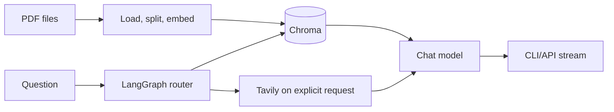

# Ibo RAG

Ibo is a prototype, source-cited PDF question-answering application built with LangGraph, LangChain, Chroma, FastAPI, and an OpenAI-compatible model provider.

## Features

- PDF ingestion with deterministic chunk IDs and persistent Chroma storage.
- Document-grounded answers with source/page citations.
- Explicit online-search route using Tavily.
- Streaming answers through the CLI and HTTP API.
- Abstention when no indexed passages are available.

## Architecture



## Setup

Requires Python 3.11+.

```bash
python -m venv .venv
source .venv/bin/activate
pip install -e ".[dev]"
cp .env.example .env
```

Set `OPENAI_API_KEY` in `.env`. Set `TAVILY_API_KEY` only if online search is needed.
For OpenRouter-compatible models, set `OPENAI_BASE_URL=https://openrouter.ai/api/v1`; models containing `/` use that URL automatically when no base URL is provided.

## Configuration

Defaults live in `configs/default.yaml`; environment variables override them.

| Variable | Required | Purpose |
|---|---:|---|
| `OPENAI_API_KEY` | Yes | Embeddings and answer generation |
| `TAVILY_API_KEY` | For web search | Explicit online search |
| `IBO_CHAT_MODEL` | No | Chat model, default `gpt-4o-mini` |
| `IBO_EMBEDDING_MODEL` | No | Embedding model, default `text-embedding-3-small` |
| `IBO_DATA_DIR` | No | PDF directory, default `data` |
| `IBO_INDEX_DIR` | No | Chroma directory, default `storage/chroma` |
| `IBO_TOP_K` | No | Retrieved chunk count, default `4` |

## Run

Index PDFs:

```bash
python -m ibo_rag.cli ingest
```

Ask from the terminal:

```bash
python -m ibo_rag.cli ask "What does the document say about ...?"
```

Run the API:

```bash
uvicorn ibo_rag.api.app:app --reload
```

Then query it:

```bash
curl -N http://localhost:8000/query \
  -H 'content-type: application/json' \
  -d '{"question":"What does the document say about ...?"}'
```

Use the exact phrase `search online` to enable Tavily.

## Testing

```bash
ruff check .
ruff format --check .
pytest tests/unit
```

Tests do not call external model providers. Live ingestion and answering require configured credentials.

## Security and privacy

Never commit `.env`, API keys, private PDFs, or generated Chroma data. Retrieved documents and web results are treated as untrusted evidence, not instructions.

## Limitations

This first version has no frontend, authentication, persistent chat history, file-upload endpoint, or deployment configuration.
